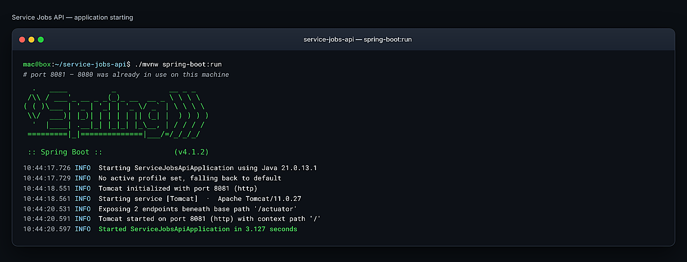
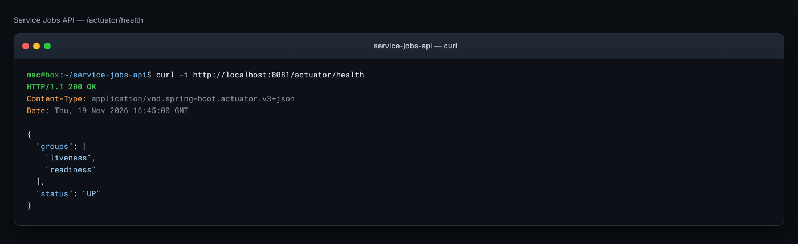
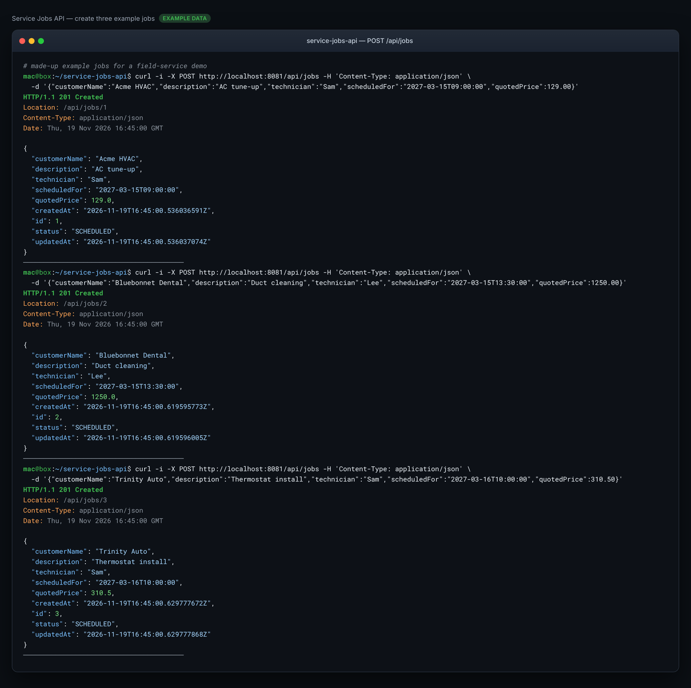
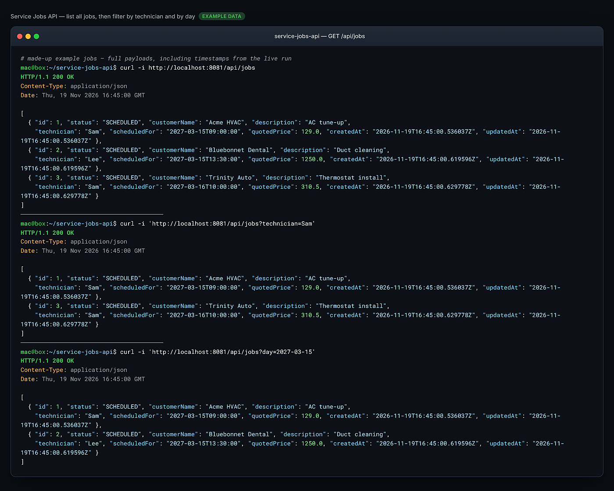
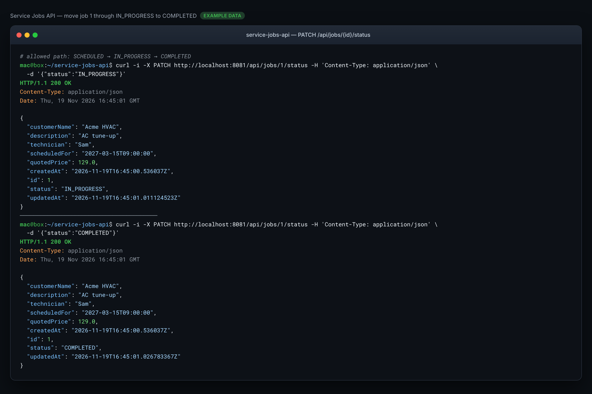
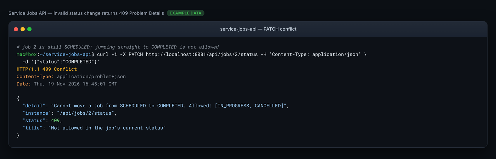
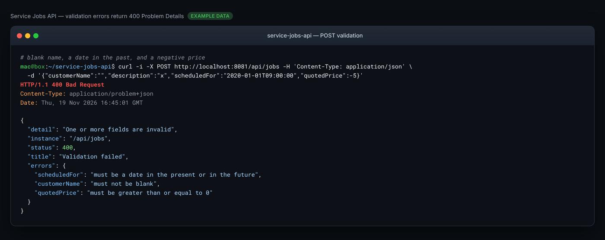
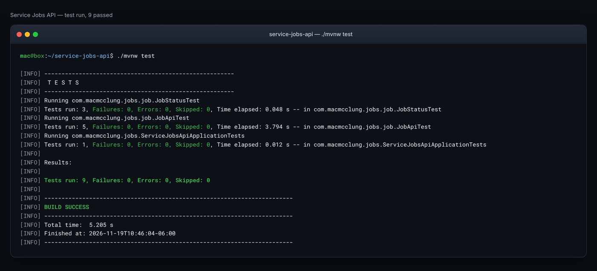

# Service Jobs API

A REST API for creating, assigning, rescheduling, and tracking field-service jobs, with domain rules that block invalid status changes.

It is for shops that need a small, well-defined jobs API rather than a full field-service platform. You can create a job, list or filter jobs, change status, reschedule or reassign a scheduled job, and delete only jobs that are still scheduled or cancelled.

The stack is **Java 21, Spring Boot 4, Spring Data JPA, Bean Validation, and an in-memory H2 database**. Errors use RFC 9457 Problem Details (`400`, `404`, `409`).

## What it shows

- A clean layered design, with a controller, a service, a repository, and the domain model
- Business rules in the domain model. A job can only move `SCHEDULED → IN_PROGRESS → COMPLETED`, or be `CANCELLED` before it's completed. Only scheduled jobs can be rescheduled, and jobs that are in progress or completed can't be deleted.
- Input validation with field-level error messages
- Consistent error responses using RFC 9457 Problem Details (`400`, `404`, `409`)
- Unit tests and full HTTP integration tests

## Endpoints

| Method | Path | Purpose |
|---|---|---|
| POST | `/api/jobs` | Create a job (returns `201` + `Location`) |
| GET | `/api/jobs?status=&technician=&day=YYYY-MM-DD` | List jobs, with an optional filter |
| GET | `/api/jobs/{id}` | Get one job |
| PATCH | `/api/jobs/{id}/status` | Change status (`{"status":"IN_PROGRESS"}`) |
| PATCH | `/api/jobs/{id}/schedule` | Reschedule or reassign a scheduled job |
| DELETE | `/api/jobs/{id}` | Delete a scheduled or cancelled job |
| GET | `/actuator/health` | Health check |

## Run

The app listens on port **8080** by default (`application.properties` does not set `server.port`, so Spring Boot's default applies).

```bash
./mvnw spring-boot:run
curl -X POST localhost:8080/api/jobs -H 'Content-Type: application/json' \
  -d '{"customerName":"Acme HVAC","description":"AC tune-up","technician":"Sam","scheduledFor":"2030-01-15T09:00:00","quotedPrice":129.00}'
```

## Test

```bash
./mvnw test
```

Data is kept in an in-memory H2 database, so every restart starts fresh. To use it for real, you would point `spring.datasource.*` at Postgres or MySQL and add migrations.

## Screenshots

All data in these screenshots is **made-up example data** for demonstration only. The live run used port **8081** because 8080 was already in use on that machine; the default port when you run the app is **8080**.

### Application starting



Spring Boot 4.1.2 starting with Java 21, Tomcat coming up, actuator endpoints exposed, and the application started in 3.127 seconds. In this run Tomcat listened on port 8081, as noted above.

### Health check



`GET /actuator/health` returns `200 OK` with `"status": "UP"`, so you can confirm the service is running before calling the job APIs.

### Creating jobs



Three `POST /api/jobs` requests create made-up field-service jobs for Acme HVAC, Bluebonnet Dental, and Trinity Auto. Each returns `201 Created`, a `Location` header (`/api/jobs/1`, `/2`, `/3`), and a body with status `SCHEDULED`.

### Listing and filtering jobs



`GET /api/jobs` lists all three jobs. Filtering with `?technician=Sam` returns the two jobs assigned to Sam, and `?day=2027-03-15` returns the two jobs scheduled that day.

### Changing status along the allowed path



A valid lifecycle: job 1 moves from `SCHEDULED` to `IN_PROGRESS`, then to `COMPLETED`. Each request returns `200 OK` with the updated status. The allowed path is `SCHEDULED → IN_PROGRESS → COMPLETED`.

### Invalid status change (409)



Trying to jump job 2 from `SCHEDULED` straight to `COMPLETED` is rejected with `409 Conflict` and an RFC 9457 Problem Details body: the job cannot move from `SCHEDULED` to `COMPLETED`; the allowed next statuses are `IN_PROGRESS` and `CANCELLED`. That business rule is enforced by the API, not only by a client.

### Validation errors (400)



A create request with a blank customer name, a date in the past, and a negative price returns `400 Bad Request` with field-level messages: the name must not be blank, the schedule must be in the present or future, and the quoted price must be at least 0.

### Test run



`./mvnw test` runs the unit and HTTP integration tests: 9 tests, 0 failures, `BUILD SUCCESS`.
